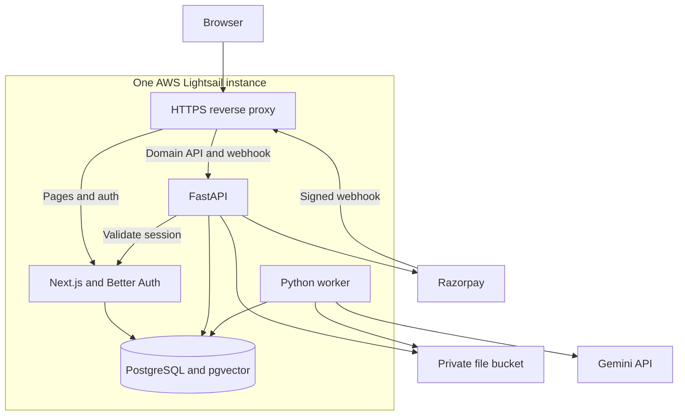

# Diffuzion — Development Blueprint

**API migration impact workbench · Solo developer MVP**  
**Planning date:** 12 October 2026, Asia/Kolkata  
**Delivery target:** 8 weeks; approximately 230–280 focused hours  
**Status:** Implementation plan, not an implemented or benchmarked system

This blueprint reconciles **GenAI_Portfolio_Project_Research(3).md** and **Pasted text(4).txt**, both read in full. The later feature agreement takes precedence: TypeScript, JavaScript, and Python are included; Java is deferred. References below are current official documentation or first-party repositories. Product defaults, architecture choices, effort estimates, and quality thresholds are explicitly planning decisions.

## 1. Project Overview

**Diffuzion helps a developer understand how an API contract change may affect selected client code.** It combines deterministic OpenAPI comparison, narrow static call-site extraction, and retrieval-grounded AI guidance.

**Core workflow:** upload old/new API specifications and selected client files → preview contract changes and candidate call sites → optionally correct mappings and select operations → generate an evidence-linked migration plan → review → export.

The expected result is an inspectable report containing contract findings, potentially affected code, relevant migration documentation, proposed steps, suggested checks, and unresolved questions. It does **not** prove runtime breakage or certify that a migration is correct.

### Validated scope and decisions

| Issue or gap                                                       | Decision for implementation                                                                                                                    | Evidence status                                              |
| ------------------------------------------------------------------ | ---------------------------------------------------------------------------------------------------------------------------------------------- | ------------------------------------------------------------ |
| Original report supports only TypeScript                           | Include `.ts`, `.js`, and `.py`; use narrow, documented call patterns                                                                          | Confirmed by later user agreement and pasted content         |
| Choosing ≤30 changed operations requires knowing the changes first | Add an uncharged, deterministic preview before AI generation; use the same worker                                                              | Engineering decision needed to make the flow executable      |
| Prices and quotas were provisional                                 | Implement configurable defaults: Free 5/month; Pro ₹199 for 50 analyses/30 days                                                                | Product hypothesis, not validated pricing                    |
| Mixed inputs and API base paths were unspecified                   | One API per project; derive a literal base URL from the old specification, or request a user override                                          | Engineering decision; never infer a dynamic base URL         |
| Many domain tables were suggested, not mandated                    | Keep bounded parsed findings/call sites in validated JSONB snapshots; use relational tables for ownership, files, retrieval, billing, and jobs | Scope reduction; no general code graph                       |
| Provider and framework integrations                                | Documentation supports the proposed mechanisms; exact dependency combinations still need a week-one smoke test                                 | Verified capabilities, untested application integration      |
| Credentials and deployment access                                  | Assume Google/GitHub OAuth apps, Razorpay test keys, AWS access, a domain, and a paid Gemini API project are available                         | Prerequisite; credentials were not inspected                 |
| Schedule                                                           | Budget about 32 hours/week over 8 weeks, assuming working React, REST, Python, SQL, and Git knowledge                                          | Estimate; learning both frameworks from scratch needs longer |

Use only the selected API-workbench requirements. RFP review, PDFs, OCR, and other second-project details from the research are not part of Diffuzion.

## 2. Problem Statement & Justification

API changelogs describe contract differences; consumers still have to locate relevant calls, interpret migration notes, and identify what the available evidence cannot establish.

| Existing solution                          | Verified overlap                                                 | Implication                                                 |
| ------------------------------------------ | ---------------------------------------------------------------- | ----------------------------------------------------------- |
| [oasdiff][oasdiff]                         | Breaking/nonbreaking contract checks and machine-readable output | Reuse it rather than reimplement compatibility rules        |
| [Bump.sh][bump]                            | Automatic changelogs and breaking-change identification          | A diff dashboard alone is insufficient differentiation      |
| [Delimit migration-guide example][delimit] | Generates guidance from API changes                              | AI-generated migration instructions are not a novelty claim |

**Differentiation hypothesis:** a small, upload-based workflow linking a contract finding to the user's selected code and documentation, with visible evidence, coverage limits, and editable recommendations. This is useful if those connections improve guidance beyond rule templates; the evaluation must demonstrate that improvement.

Specifications can omit business behavior; URLs can be dynamic; documentation can be wrong. Restricting inputs makes these limitations observable. It does not solve them universally. No customer adoption or time-saving claims have been validated.

## 3. Goals & Success Criteria

All numerical values below are **initial targets, not results**. Publish actual counts and failures even when a target is missed.

| Area                   | Release target and measurement                                                                                                                                 |
| ---------------------- | -------------------------------------------------------------------------------------------------------------------------------------------------------------- |
| Complete product       | Two independent users can sign in, upload, analyze, review, export, and see only their own data; test checkout activates Pro                                   |
| Supported code mapping | Precision ≥95%, recall ≥90% within the documented subset; report TS/JS/Python separately with denominators                                                     |
| Coverage honesty       | Show analyzed/skipped files, recognized calls, mapped calls, unresolved candidates, and parse errors; never claim enumeration of every arbitrary HTTP call     |
| Retrieval              | Hit@8 ≥90% on held-out cases with a labelled relevant note passage; report actual numerator/denominator                                                        |
| Evidence integrity     | 100% of published evidence IDs and source locations resolve within the saved run inputs                                                                        |
| Guidance benefit       | On documentation-dependent held-out cases, target ≥1 point improvement on the 0–8 rubric over rule templates, without increasing unsupported actionable claims |
| Abstention             | ≥90% of labelled missing-information cases retain the required unknown instead of inventing a migration                                                        |
| Performance            | Typical run: ≤10 changed operations, ≤5 code files, ≤3 short notes; target median execution <90 seconds, excluding queue wait; publish p95 separately          |
| Cost                   | Target typical AI cost <US$0.05/run; measure billed usage, retries, embeddings, and uncertain timeout costs                                                    |
| Reliability            | Quota races, duplicate payment events, stale worker attempts, and cross-user access tests pass                                                                 |
| Deployability          | Clean-checkout setup, repeatable migrations, passing CI, deployed HTTPS demo, and one documented backup restore                                                |

Failure to meet a quality target calls for narrowing supported patterns or improving retrieval on development cases. Do not tune repeatedly against held-out results or hide failed cases.

## 4. Scope & Target Users

**Primary user:** a developer maintaining a small REST API consumer who can supply both specification versions and representative source files. **Admin:** the project owner operating the demo. There are no teams or shared workspaces.

### Pages and feature flow

| Page / access           | Essential behavior                                                                                                                           |
| ----------------------- | -------------------------------------------------------------------------------------------------------------------------------------------- |
| Landing — visitor       | Problem, example report, supported patterns, limits, pricing, privacy/help, Get started and Sign in                                          |
| Sign-in — visitor       | Google/GitHub login; safe return to an intended local page; GitHub login grants no repository access                                         |
| Onboarding — new User   | Brief workflow and hosted-AI disclosure; no questionnaire or mandatory profile enrichment                                                    |
| Plans / checkout — User | Continue Free or buy Pro; payment failure never blocks Free access; upgrade remains available later                                          |
| Dashboard — User        | Projects, recent runs, states, quota/reset/expiry, and one sample-project import; running the sample uses normal quota                       |
| Project — owner         | Create/name/describe/rename; upload or reuse files; create immutable revisions; optional API base URL override; history; delete              |
| Setup / preview — owner | Validate inputs, display deterministic changes and coverage, manually map recognized unresolved calls, select ≤30 changed operations         |
| Run status — owner      | Persistent stage/status; leave and return; bounded retry; explicit failure and usage outcome                                                 |
| Report — owner          | Severity/operation/language/review filters; read-only code and evidence viewer; AI steps, assumptions, checks, unknowns                      |
| Review / export — owner | Accept/edit/reject recommendations; save original and edited text separately; Markdown/JSON downloads                                        |
| Account — User          | Basic profile, plan, usage, payment history, privacy information, sign out                                                                   |
| Admin — Admin           | Operational counts, redacted failures, AI cost estimates, suspend/reactivate, reconcile stuck usage/payments, audited exceptional revocation |

Authenticated users with incomplete onboarding resume it; other authenticated users go to Dashboard. On `/`, unauthenticated visitors see Landing; a harmless “visited before” flag may suggest Sign in but must not control access. The server cannot reliably identify an anonymous returning person. Protected links redirect to sign-in, then recheck ownership.

### Supported input contract

| Input                   | MVP limit / rule                                                                                                   |
| ----------------------- | ------------------------------------------------------------------------------------------------------------------ |
| Specifications          | Exactly two self-contained OpenAPI **3.0.x** JSON/YAML files; ≤100 operations in **each**; ≤2 MiB each             |
| Source                  | 1–20 UTF-8 `.ts`, `.js`, `.py` files **combined**; ≤256 KiB each; no archives, JSX/TSX, notebooks, or repositories |
| Migration notes         | Optional; ≤10 `.md`/`.txt` files, ≤100 KiB each; ≤40,000 embedding-input tokens and ≤200 chunks per revision       |
| Whole revision          | ≤12 MiB source bytes; reject invalid/excess inputs explicitly                                                      |
| AI scope                | ≤30 selected changed operations; deterministic preview still shows all detected contract findings                  |
| Stored source allowance | Free 50 MiB; Pro 250 MiB; count project-scoped unique stored files, not reused revision references                 |

Limits are conservative defaults to verify with fixtures. If a request exceeds a limit, explain how to reduce scope; never silently select the first files or operations.

**Excluded:** Java; Axios/custom wrappers/generated SDK analysis; whole-program/data-flow analysis; arbitrary URL ingestion; repository cloning or GitHub integration; PR creation; automatic patches; execution of uploaded code/tests; live API probing; chat/agents/tool orchestration; model training; PDF/OCR; collaboration/enterprise RBAC; automatic subscription renewal, top-ups, coupons, tax invoices; Kubernetes/microservices/Redis/Celery; streaming and rerankers.

## 5. Functional & Non-Functional Requirements

### Required behavior

| Priority | Requirement / acceptance rule                                                                                                                                          |
| -------- | ---------------------------------------------------------------------------------------------------------------------------------------------------------------------- |
| Must     | FastAPI verifies the current session, account status, and ownership on every protected resource operation; frontend checks are only an additional layer                |
| Must     | Original uploads and completed run inputs remain immutable; changing files or mappings creates a new run snapshot; historical results identify their versions          |
| Must     | Contract findings remain separate from generated suggestions; no model-derived severity replaces the deterministic severity                                            |
| Must     | Evidence is resolved by the server; no invented file names, unrestricted URLs, or cross-project evidence                                                               |
| Must     | “No changes,” “no matched calls,” “no notes,” unsupported patterns, quota exhausted, payment pending, and service failure have explicit UI states                      |
| Must     | Successful new AI report consumes one unit; terminal technical failure releases its unit once; preview, cached-result reuse, reading, editing, and export consume none |
| Must     | Repeated clicks, callbacks, and webhooks cannot create duplicate jobs, quota debits, or passes                                                                         |
| Must     | User/Admin roles are independent of Free/Pro entitlements; Admin has no blanket private-content access                                                                 |
| Must     | Files, chunks, vectors, reports, and reviews follow project deletion; billing history and aggregate usage counters remain separate                                     |
| Should   | Usable desktop/laptop UI, clear empty states, keyboard-operable forms, and responsive basic layouts; decorative polish is lower priority                               |

### Service targets and constraints

- One deployment, one API process, one worker, one PostgreSQL database; no high-availability promise.
- Ordinary list/status endpoints target p95 <1 second on light demo traffic, measured separately from uploads, checkout verification, and AI execution.
- One active preview/analysis job per user; one compute-heavy job globally; cap waiting jobs at five and return a retryable busy response when full.
- Poll active jobs every three seconds; stop polling terminal states and slow down in background tabs.
- Keep request IDs, stage timings, provider usage, and redacted error codes; do not log source contents, cookies, OAuth tokens, or secrets.
- Quotas use UTC boundaries; dates display in the user's local timezone. Store all instants as timezone-aware timestamps.

## 6. System Architecture & Technical Design

### Components and boundaries

Next.js owns presentation and authentication. FastAPI owns domain rules, ownership, quotas, and billing. The worker imports the **same Python modules/image** as FastAPI; it is a process for durable background work, not an independent microservice. PostgreSQL is both the application database and small job queue.

Route `/api/auth/*` to Next.js, `/api/v1/*` to FastAPI, and other paths to Next.js. Only the reverse proxy exposes application web ports. Generate exports on demand from saved results; no separate export service or export table.

### Authentication and authorization contract

1. Mount Better Auth's Next.js handler at `/api/auth/[...all]`; use its PostgreSQL adapter and Google/GitHub providers. Register exact development/production callback URLs. Keep OAuth state and origin protections enabled. [Next.js integration][auth-next] · [Google][auth-google] · [GitHub][auth-github]
2. Use Secure, HttpOnly, SameSite=Lax cookies in HTTPS production. Set seven-day sessions, `disableSessionRefresh: true`, and disable cookie caching. This avoids needing to relay refreshed cookies through FastAPI. [Session behavior][auth-session]
3. FastAPI's reusable dependency sends the allowlisted session cookie to the fixed internal `http://web:3000/api/auth/get-session?disableCookieCache=true`. Use a short timeout, no redirects, and no caller-controlled verification URL. Validate the response shape, session expiry, and matching session/user identifiers. Do **not** decode the opaque cookie as a JWT.
4. Load/create `app_accounts` using the verified user ID, then check current `status` and `role`. Load entitlements from application tables. Return 401 for invalid sessions, 403 for suspended accounts/forbidden Admin actions, 404 for another user's resource, and 503 when verification is unavailable.
5. Require owner filtering for files, revisions, jobs, evidence, exports, purchases, and retrieval. Do not accept a client-supplied owner/role/plan. Seed the initial Admin through an operator CLI. Frontend page guards must validate sessions; cookie-existence redirects alone are insufficient.

Do not write custom provider-account merging. Account linking UI, passwords, and password recovery are excluded. Auth tables are migration-owned by Better Auth; application tables are Alembic-owned. Use separate `auth` and `app` schemas, configure the auth connection's `search_path`, and validate the generated schema before applying application foreign keys. [PostgreSQL adapter][auth-pg]

### Deterministic preview and language extraction

**Preview:** freeze the revision → enqueue an uncharged `preview` run → safely parse/validate specs → run pinned `oasdiff changelog ... --format json --allow-external-refs=false` on local files → extract/map call candidates → save validated preview JSONB. Never use `--open` or upload the comparison to another service. The changelog omits documentation-only edits; label an empty result **“No detected consumer-facing contract changes,”** not “files are identical.” Preserve original engine output and engine version. [oasdiff output semantics][oasdiff]

After rejecting external references, validate the parsed object with `openapi-spec-validator` and its explicit `OpenAPIV30SpecValidator`; never call its URL-loading helper. If no changed operations exist, disable AI generation and allow preview export without charging. Global-only findings remain in that preview. [Specification validation][spec-validator]

Use canonical `METHOD /path/{parameter}` operation keys; `operationId` is optional metadata, not a required unique key. Keep unmapped/global findings visible. Preserve original JSON Pointers; when a field pointer is unavailable, cite a verified enclosing operation/component and label the coarser location.

| Language                | Parser and supported rules                                                                                                                                                                                                      |
| ----------------------- | ------------------------------------------------------------------------------------------------------------------------------------------------------------------------------------------------------------------------------- |
| TypeScript / JavaScript | Python Tree-sitter bindings with official TS/JS grammars; direct `fetch(url)` defaults to GET; literal `method` in a literal options object; literal URLs or template strings whose substitutions occupy complete path segments |
| Python                  | Standard-library `ast`; unaliased `import requests` and direct `requests.get/post/put/patch/delete/head/options(...)`; literal URLs or simple f-strings with complete-segment name substitutions                                |
| All                     | No import resolution, constant propagation, concatenation, wrapper expansion, SDK inference, or execution; visible syntax/shadowing ambiguities are unresolved                                                                  |

Normalize HTTP method and remove query/fragment for path matching. Match absolute URLs only against the declared/confirmed API origin and base path; accept leading-slash relative paths. Match the **old** contract first, prefer an exact static path, then a unique parameterized path; ambiguous matches require user review. Do not guess that a removed endpoint or field was renamed.

Each extractor returns one common `CallSite`: file ID, language, byte span and one-based line range, method, URL pattern, candidate operation keys, mapping source (`automatic`/`manual`), and unresolved reason. Normalize parser coordinate conventions, including UTF-8 offsets. The UI allows manual mapping of detected candidates; a general arbitrary-span annotation editor is deferred. Java later needs another extractor and fixtures while reusing RAG/billing/reporting. [Tree-sitter][tree-sitter] · [TS grammar][ts-grammar] · [JS grammar][js-grammar] · [Python AST][python-ast]

### One bounded GenAI workflow

| Stage            | Implementation                                                                                                                                                                                                                                                               |
| ---------------- | ---------------------------------------------------------------------------------------------------------------------------------------------------------------------------------------------------------------------------------------------------------------------------- |
| Index notes      | Split by headings/paragraphs into roughly 300-token passages with ~40-token overlap; preserve file ID, heading, line/character spans, and chunker version. Enforce total limits before API calls                                                                             |
| Embed            | Embed notes only; schema and code evidence are obtained exactly. Use `gemini-embedding-2`, 768 dimensions, one vector **per passage**; validate vector count/dimension                                                                                                       |
| Retrieve         | Build query from operation, change type, affected field names, and version labels. Filter owner/project/selected revision files **before** ranking. Retrieve top 20 lexical and top 20 cosine matches; reciprocal rank fusion with `1/(60+rank)`; retain top 8 per operation |
| Assemble context | Include deterministic finding, old/new contract excerpts, mapped code spans, selected note passages, and allowed evidence IDs. Deduplicate repeated passages. Missing notes remain missing                                                                                   |
| Generate         | Stateless `gemini-3.5-flash-lite` calls; group up to three operations when their context fits. Request JSON Schema generated from Pydantic; no tools, agent loop, web grounding, or shell access                                                                             |
| Validate         | Validate schema, selected operation/finding IDs, call-site associations, every citation, list/text limits, and input revision. One bounded repair attempt; never display invalid output as a successful report                                                               |
| Persist / review | Save original structured output, evidence catalogue, input fingerprint, versions, token/cost/timing metrics. User edits are separately labelled user-authored                                                                                                                |

With no notes, skip embedding/retrieval and use contract/code evidence with explicit unknowns. With no mapped calls, label guidance as contract-level; never imply code impact was established. Source/mapping changes produce a new run; flag older reports as belonging to earlier inputs without rewriting them.

**Embedding API detail:** Embedding 2 uses task instructions, not the older `task_type` parameter. Use query prefix `task: search result | query:` and document format `title: … | text: …`. Multiple raw inputs can aggregate into one embedding; use separate calls or the documented separate-Content/batch form. Model/config changes require re-embedding, not mixing vector spaces. [Embedding contract][embeddings]

**Generation API:** use the current Google GenAI SDK's Interactions API with `store=false`; use `response_format` with JSON MIME type and the Pydantic schema. Keep generation and embedding calls in one small provider module. Structured JSON does not establish semantic truth. [Interactions][interactions] · [Structured output][structured] · [Model capabilities][gen-model]

**Output contract per operation:** `operation_key`, `change_ids[]`, `candidate_callsite_ids[]`, `status` (`guidance_available`/`needs_information`/`unsupported`), `steps[{id,instruction,evidence_ids}]`, `suggested_checks[]`, `assumptions[]`, `unknowns[]`. The server assigns stable recommendation IDs. Each actionable step needs evidence; speculative checks must be labelled as proposed. Conflicting sources remain visible. No unsupported confidence percentages or claims that accepted advice is “fixed.”

Initial budgets: ≤12,000 input tokens and ≤2,048 output tokens per call; ≤160,000 total generation-input tokens, ≤32,000 billed output/thinking tokens, and ≤40,000 embedding tokens per run including retries. Pack fewer operations when needed; if even one operation's required evidence cannot fit, return an explicit scope/context error and release quota. Never silently omit required findings. Use at most ten primary generation calls, two transient retries total, and one repair call within these budgets. Set an eight-minute execution deadline; typical runs should be much smaller.

### Database schema and relationships

Use UUIDs for application resource IDs, `timestamptz`, integer paise, and fixed-precision decimals for AI cost. Keep Better Auth IDs in their generated string type; assert that type before application migrations. Application account creation is idempotent after a verified session.

| Table                                             | Key fields / constraints                                                                                                                                                                                                                                                                                                          |
| ------------------------------------------------- | --------------------------------------------------------------------------------------------------------------------------------------------------------------------------------------------------------------------------------------------------------------------------------------------------------------------------------- |
| `auth.user`, `session`, `account`, `verification` | Generated/managed by Better Auth; application migrations do not modify them                                                                                                                                                                                                                                                       |
| `app_accounts`                                    | `user_id` PK/FK to auth user; `role`, `status`, `onboarded_at`, `stored_bytes`, `reserved_upload_bytes`                                                                                                                                                                                                                           |
| `projects`                                        | `id`, `owner_user_id` FK, `name`, `description`, `api_base_url`, `status`; owner index                                                                                                                                                                                                                                            |
| `files`                                           | `id`, `project_id` FK, `original_name`, `kind`, `language`, `sha256`, `storage_key`, `size_bytes`, `state`, `parse_cache_json`, parser version; project-scoped deduplication                                                                                                                                                      |
| `revisions`                                       | `id`, `project_id` FK, optional `parent_revision_id`, snapshotted `api_base_url`, `created_at`, `frozen_at`; immutable once preview starts                                                                                                                                                                                        |
| `revision_files`                                  | `(revision_id,file_id)` PK/FKs, role `old_spec/new_spec/code/note`; unique old/new spec slots; same-project check in service transaction                                                                                                                                                                                          |
| `note_chunks`                                     | `id`, `file_id` FK, spans/heading/text, chunk index/version, embedding model/version, `vector(768)`, `tsvector`; unique file/config/chunk; GIN lexical index                                                                                                                                                                      |
| `runs`                                            | `id`, owner/project/revision FKs, optional `preview_run_id` self-FK, `kind=preview/guidance`, idempotency key/request hash/fingerprint, frozen scope/mappings; `state`, `stage`, `attempts`, `lease_token`, `lease_until`, heartbeat/timestamps; result/checkpoint JSONB, quota period/state, AI budget reservation, usage/errors |
| `reviews`                                         | `(run_id,recommendation_id)` PK, `decision`, optional edited instruction/evidence IDs, `version`, timestamps; only valid saved recommendations                                                                                                                                                                                    |
| `quota_periods`                                   | `id`, owner FK, `kind`, `starts_at`, `ends_at`, `limit`, `reserved`, `consumed`, optional unique purchase FK, `revoked_at`; unique Free owner/month                                                                                                                                                                               |
| `purchases`                                       | `id`, owner FK, plan, amount/currency/mode, unique provider order/payment IDs, creation idempotency key, state, immutable `fulfilled_at`; one pending purchase per owner                                                                                                                                                          |
| `webhook_events`                                  | Unique `(mode,event_id)`, body hash, minimal verified event fields, processing state/attempts/next retry/error; exclude unnecessary payment PII                                                                                                                                                                                   |
| `ai_budget_months`                                | UTC month PK, configured cap, reserved amount, conservatively charged amount; locked during admission/settlement                                                                                                                                                                                                                  |
| `admin_audit`                                     | Actor, action, target ID, reason, timestamp, limited before/after values; no private source text                                                                                                                                                                                                                                  |

Relationships: account → projects/purchases/quota periods; project → files/revisions/runs; revision ↔ files through `revision_files`; file → note chunks; run → reviews; purchase → at most one Pro quota period. A guidance run references a completed preview of the same revision/configuration. Preview findings and call sites are bounded JSONB, not additional graph tables. Preview quota fields are null; guidance quota state is `reserved`, `consumed`, or `released`.

Important indexes/invariants: one queued/running run per owner via partial unique index; unique owner/kind/idempotency key; FIFO job index on state/created time; owner/project indexes; unique fulfilled payment/order bindings; nonnegative quota counters with `reserved + consumed ≤ limit`. Enforce at most one active Pro pass under an account-row lock, since a time-dependent “currently active” partial index is inappropriate.

### Key API contracts

All domain routes use `/api/v1`. Bodies are Pydantic-validated; frontend types come from the generated OpenAPI schema. Return `{error:{code,message,request_id,details?}}` consistently. Paginate history lists, default 20/max 100. Ownership checks also apply to nested IDs in request bodies.

| Method / route                                                                                                                                      | Request → response / rule                                                                                                                    |
| --------------------------------------------------------------------------------------------------------------------------------------------------- | -------------------------------------------------------------------------------------------------------------------------------------------- |
| `GET /me`; `PATCH /me/onboarding`                                                                                                                   | Verified account, role, plan/usage; onboarding acknowledgement only, no role/plan updates                                                    |
| `GET/POST /projects`; `GET/PATCH/DELETE /projects/{id}`                                                                                             | List/create/read/rename/delete own projects; deletion returns 202 while cleanup finishes                                                     |
| `POST /projects/sample`                                                                                                                             | Copies the curated sample into this user's project; source allowance applies                                                                 |
| `POST /projects/{id}/files`                                                                                                                         | One bounded multipart file + kind → file ID/hash; reserve storage under account lock before upload; release on failure                       |
| `POST /projects/{id}/revisions`                                                                                                                     | Old/new spec IDs, code IDs, note IDs, optional parent → validated revision ID                                                                |
| `POST /revisions/{id}/preview`                                                                                                                      | Required `Idempotency-Key` → 202 run ID/status URL; completed cached preview → 200 existing run                                              |
| `POST /revisions/{id}/analyses`                                                                                                                     | Preview ID, selected operation keys, manual mapping overrides + idempotency key → 202 run ID; identical completed result → 200 without debit |
| `GET /projects/{id}/runs`; `GET /runs/{id}`                                                                                                         | History; state/stage, coverage, error, quota disposition, result when available                                                              |
| `GET /runs/{id}/evidence/{evidence_id}`                                                                                                             | Authorized source excerpt/pointer/span only; ID must belong to that run                                                                      |
| `PUT /runs/{id}/reviews/{item_id}`                                                                                                                  | Decision, optional edited text, expected review version → saved review; conflicting edit → 409                                               |
| `GET /runs/{id}/export?format=md\|json`                                                                                                             | Authorized download including input versions, findings, coverage, original/user-edited guidance and review state                             |
| `GET /billing/catalog`; `GET /billing/purchases`                                                                                                    | Server-owned plan/price/public key/mode; own purchase history                                                                                |
| `POST /billing/orders`                                                                                                                              | Plan code + idempotency key → internal purchase ID, provider order ID, public checkout fields; never accept price from browser               |
| `POST /billing/verify`                                                                                                                              | Purchase ID, payment ID, signature → active/pending/rejected; verify saved order binding                                                     |
| `POST /billing/purchases/{id}/reconcile`                                                                                                            | Rate-limited provider status recheck; no client assertion can activate a pass                                                                |
| `POST /billing/webhooks/razorpay`                                                                                                                   | Raw body + HMAC headers; no session/CSRF requirement; persist valid event before 2xx                                                         |
| `GET /admin/overview`; `GET /admin/accounts`                                                                                                        | Admin-only redacted operations/account views                                                                                                 |
| `PATCH /admin/accounts/{id}/status`; `POST /admin/runs/{id}/reconcile`; `POST /admin/purchases/{id}/reconcile`; `POST /admin/purchases/{id}/revoke` | Explicit bounded actions, required reason, audit entry; revocation does not initiate a refund                                                |
| `GET /health/live`; `GET /health/ready`                                                                                                             | Liveness; DB/basic dependency readiness without a paid AI call or secret disclosure                                                          |

Use 413 for size limits, 422 for invalid/unsupported inputs, 409 for conflicts or exhausted plan quota, 429 with `Retry-After` for rate limits, and 503 for unavailable services/global budget/queue capacity. On 401 the UI offers sign-in while preserving a safe local return path. Store payment pending state server-side, not only in browser memory.

### Freemium accounting and payment state

**Free:** 5 AI reports per UTC calendar month. **Pro:** ₹199 (`19900` paise, INR), 50 reports over 30 days from the first verified activation. Same technical caps and full core functionality. An active Pro pass takes precedence; exhausting it does not fall back to Free. After expiry, return to the current Free period with its earlier consumption intact. Existing reports stay accessible; storage overage blocks new uploads, not reading/deletion. No renewal or stacking.

**Atomic admission:** verify completed preview/selection → lock account → resolve idempotency/cache hit → check active job and entitlement → lock applicable quota and AI budget rows → reserve one unit and ≤US$0.15 estimated maximum AI cost → insert guidance run → commit. Reject reuse of an idempotency key with a different request hash. On success, consume the unit and settle actual cost; on terminal failure, release the unit once and retain incurred/conservative AI cost. A run accepted before plan expiry finishes against its original period. Internal retries reuse the reservation; an explicit retry after terminal failure uses a new key.

**Razorpay flow:**

1. Create a local pending purchase with server catalogue values; create the provider order outside the DB transaction, using the purchase UUID as receipt. Reuse that pending order for checkout retries. If creation times out ambiguously, retain `creation_unknown`; do not blindly create another order. An Admin may supply the discovered order ID for reconciliation, but the server must fetch it and match receipt, amount, currency, and mode before binding it. Unbound events cannot grant access.
2. Open Standard Checkout with the saved order ID. Treat cancellation/failure as a payment-attempt outcome, not proof that the order can never be paid.
3. On callback, validate HMAC using the **server-saved order ID**, then fetch provider payment/order and verify binding, amount, currency, captured payment, paid order, and no refunded amount. Mode is established by the server credentials and saved purchase, not an assumed payment-ID pattern. Authorized-only payment remains pending. Enable automatic capture in the test dashboard. [Checkout verification][razor-checkout]
4. For webhooks, validate `X-Razorpay-Signature` against raw bytes using the webhook secret before JSON parsing. Deduplicate by `x-razorpay-event-id`; also deduplicate by purchase/payment because distinct events can describe one purchase. Persist minimal validated event data before acknowledgement. [Webhook guarantees][razor-webhooks]
5. Callback and webhook processing call the same transactional fulfillment function: lock account/purchase → recheck binding/state → create one Pro quota period → set immutable `fulfilled_at` → commit. Duplicate/out-of-order events cannot extend or reactivate a fulfilled/revoked pass.
6. Process pending events before/between analysis stages, retry transient failures, and support user/Admin reconciliation by provider fetch. Show “verification pending” until resolved. Do not turn a later captured payment into failure because an older event arrives.

Only the operator handles exceptional refunds in Razorpay's dashboard and then revokes/reconciles the app entitlement with a reason. Test/live records and secrets are separated; the portfolio deployment uses **Test mode** visibly throughout.

### Repository layout

| Path                                   | Contents                                                                                                               |
| -------------------------------------- | ---------------------------------------------------------------------------------------------------------------------- |
| `apps/web/`                            | Next.js routes/pages; `lib/auth.ts`, API client/generated types; feature components; auth migrations                   |
| `apps/api/app/`                        | `main.py`, `core/` configuration/auth/errors; `modules/projects`, `analysis`, `billing`, `admin`; `db/` models/session |
| `apps/api/app/modules/analysis/`       | `extractors/`, `diff.py`, `retrieval.py`, `generation.py`, `schemas.py`, versioned prompts                             |
| `apps/api/app/worker.py`               | Job claim/recovery, pipeline execution, small billing/cleanup maintenance loop                                         |
| `apps/api/alembic/`; `apps/api/tests/` | Application migrations; unit/integration tests                                                                         |
| `evals/`                               | Fixture manifests, development/held-out cases, labels, baseline runner, result reports                                 |
| `infra/`                               | Dockerfiles, Compose, proxy configuration, deployment/backup/restore scripts                                           |
| `.github/workflows/`; `docs/`          | CI/deploy workflows; setup, decisions, limits, API examples, benchmark/runbook                                         |

Use router → service function → SQLAlchemy query. Add small helpers only when shared; no generic repository framework, event bus, or plugin architecture.

## 7. Technology Stack & Technical Decisions

| Selection                                             | Responsibility and trade-off                                                                                                                             |
| ----------------------------------------------------- | -------------------------------------------------------------------------------------------------------------------------------------------------------- |
| Next.js App Router + TypeScript                       | UI, auth routes, protected page layouts; ordinary forms and polling, not a separate frontend state platform                                              |
| Better Auth + native PostgreSQL adapter               | Google/GitHub sessions; internal validation hop costs one small request but avoids custom token verification                                             |
| FastAPI + Pydantic + SQLAlchemy 2 + Alembic + psycopg | Typed API, explicit services, transactions, migrations; keep one consistent DB session pattern                                                           |
| PostgreSQL + pgvector + built-in FTS                  | Ownership/billing/jobs and hybrid retrieval together; exact vector search is sufficient for ≤200 chunks/revision; no HNSW initially [pgvector][pgvector] |
| oasdiff pinned binary                                 | Proven contract checks; a small versioned adapter normalizes its output; test the installed JSON schema/exit behavior                                    |
| Tree-sitter TS/JS; Python `ast`                       | Structural extraction without executing source; stdlib Python parsing avoids an unnecessary third grammar dependency                                     |
| Google GenAI Python SDK                               | One generation and one embedding model; model IDs and prompt/config versions recorded; no LangChain/LangGraph required                                   |
| Private Lightsail bucket + boto3 S3 client            | Raw files outside the public web root; local filesystem implementation for development; use only put/get/delete helpers [Bucket access][bucket]          |
| Docker Compose + Caddy + Lightsail                    | One host and automated HTTPS; downtime on restart is acceptable; no additional gateway/load balancer                                                     |
| pytest + Playwright + Ruff + TypeScript checks        | Business invariants and a few end-to-end flows; real PostgreSQL in integration tests                                                                     |
| GitHub Actions + GHCR                                 | Build once, deploy image digests; secrets stay out of images and pull-request jobs                                                                       |

Start with Python 3.12, Node.js 24 LTS, Next.js 16, and PostgreSQL 17 as **compatibility targets**. Resolve supported patch releases and pin Python/Node lockfiles, grammar packages, oasdiff checksum/version, and image digests in week one. These combinations have not been run for this blueprint; record the passing combination instead of inventing “tested versions.”

**Model decision:** start with stable `gemini-3.5-flash-lite` and `gemini-embedding-2`. The documentation verifies structured-output support and configurable embeddings, not migration-analysis quality. Test five development cases immediately; if insufficient, compare one stronger current Gemini model on development cases only, recheck cost/latency, then freeze the winner before held-out evaluation. Use paid API processing for uploads; `store=false` disables conversation-state storage, not every provider retention obligation. No provider failover system is needed.

## 8. Development Roadmap & Implementation

**Baseline: eight weeks, roughly 252 planned hours within a 230–280-hour range.** Each week leaves a demonstrable increment. The tasks below are dependency ordered; do not expose public AI execution before the quota and budget controls exist.

### Week 1 — Feasibility and foundation · ~30 hours

- [ ] Create repository, lockfiles, development Compose, CI lint/build skeleton, auth/app migration ownership, and environment template.
- [ ] Configure both OAuth providers; validate the cookie through FastAPI; provision two users and an operator-assigned Admin; test revocation and ownership on a minimal project endpoint.
- [ ] Spike oasdiff on one spec pair, each language extractor on representative calls, and grounded output on five local development cases; record supported patterns and dependency versions.
- [ ] Deploy an HTTPS skeleton early; keep AI execution disabled publicly. Define fixture families and development/test split before tuning.

**Acceptance:** both social logins work on the deployed origin; a forged cookie/role fails; all three parser spikes produce source spans; output IDs can be validated. If the narrow parser or grounded guidance fails here, narrow patterns before building more UI.

### Week 2 — Inputs and deterministic preview · ~36 hours

- [ ] Implement projects, source limits/storage reservations, sample import, revisions, safe parsing, and private retrieval/download helpers.
- [ ] Build the durable preview worker, status polling, oasdiff normalization, TS/JS/Python extraction, old-operation matching, and manual mapping controls.
- [ ] Add coverage/error states, immutable snapshots, version identifiers, source viewer, and cross-owner API tests.

**Acceptance:** two specs plus mixed source files produce a saved, inspectable preview; external refs and oversized input fail; ambiguous paths remain unresolved; restarting the worker recovers preview work.

### Week 3 — Retrieval and usage controls · ~34 hours

- [ ] Implement note chunking/spans, per-passage embeddings, lexical/vector retrieval, fusion, revision/owner filters, and versioned caches.
- [ ] Implement Free/Pro period logic using seeded test purchases, atomic run reservations, AI budget reservation/settlement, idempotency, and queue/rate limits.
- [ ] Finish development labels and held-out fixture manifest; add retrieval diagnostics and initial rules-only baseline.

**Acceptance:** retrieved evidence belongs only to selected revision files; lexical/vector/fused Hit@8 can be measured; two concurrent requests with one remaining unit cannot both succeed; provider work stops at budget admission failure.

### Week 4 — Complete GenAI workflow · ~34 hours

- [ ] Build bounded context assembly, structured generation, ID/association validation, abstention, retry/repair limits, and per-batch checkpoints.
- [ ] Finish report filters/evidence navigation, accept/edit/reject, review conflict handling, history, and Markdown/JSON export.
- [ ] Add no-change/no-note/no-match states, identical-result reuse, local token/cost reporting, and failed-run quota settlement.

**Acceptance:** a user can finish upload → preview → AI plan → review → export; fabricated citations never appear as valid output; original and edited instructions remain distinguishable. This is the core product milestone.

### Week 5 — Razorpay and operational UI · ~30 hours

- [ ] Build catalogue/order/checkout/verify flow, pending purchase recovery, raw-body webhooks, durable deduplication, and one fulfillment function.
- [ ] Complete plans/onboarding routing, usage/expiry display, payment history, Admin status/reconciliation/revocation, and audit entries.
- [ ] Test callback/webhook races, incorrect amounts, authorized-only states, checkout cancellation, late success, duplicate capture, and revoked-pass replay.

**Acceptance:** a Razorpay test payment grants exactly one 30-day/50-run pass; a forged callback grants nothing; failure/cancellation preserves access to Free; late confirmation recovers without another purchase.

### Week 6 — Quality and failure cases · ~30 hours

- [ ] Run A/B/C baselines on development cases; inspect citation entailment and unsupported instructions; adjust only documented failure modes.
- [ ] Complete malformed-input, prompt-injection, cross-user, CSRF, worker-lease, provider-timeout, cache-invalidation, and deletion tests.
- [ ] Add the small Playwright suite; verify both real social providers manually; measure the typical workload and memory peaks.

**Acceptance:** core trust-boundary tests pass; the evidence workflow improves relevant development cases over templates; limitations are documented without hiding unsupported cases.

### Week 7 — Release deployment and recovery · ~28 hours

- [ ] Complete GHCR image builds/deployment, migration ordering, health checks, protected secret handling, log rotation, and rollback instructions.
- [ ] Enable daily off-host DB backups/short snapshot retention; restore to a disposable database and verify private file references.
- [ ] Exercise the deployed end-to-end journey, observe memory/cost/queue behavior, fix major UX failures, and freeze model/prompt/parser versions.

**Acceptance:** deployment from a tagged commit is repeatable; a simulated bad release can revert its images; a backup is actually restorable; only intended network ports are exposed.

### Week 8 — Held-out evaluation and portfolio · ~30 hours

- [ ] Run the frozen held-out evaluation once for the release; report raw counts, per-language metrics, rubric results, latency, cost, and failures.
- [ ] Finish README, architecture/decision notes, API examples, limitations, sample files, screenshots, and a 3–5 minute demo video.
- [ ] Complete the final checklist; use remaining time for defects and contingency, not additional integrations.

**Acceptance:** a reviewer can reproduce setup and evaluation from a clean checkout, inspect evidence, and use the deployed demo. If held-out targets fail, disclose them; any tuned follow-up needs a new untouched evaluation set.

**Six-week option:** the same scope requires roughly 39–47 hours/week and prior stack familiarity. Merge adjacent weeks and simplify styling/filter polish; do not remove the third language, ownership, payment verification, durable jobs, or evaluation. If fewer hours are available, extend the schedule rather than claiming this is a six-week project.

## 9. Testing & Quality Assurance

### Essential automated/manual coverage

| Layer                | Tests that justify their effort                                                                                                                                                                                                                            |
| -------------------- | ---------------------------------------------------------------------------------------------------------------------------------------------------------------------------------------------------------------------------------------------------------- |
| Parser/diff unit     | Default GET/literal method; Python verbs; static vs parameter paths; query strings/base paths; complete-segment templates; ambiguous/shadowed/dynamic calls; syntax errors; JSON Pointer escaping; removed operation; global finding; pinned engine output |
| API + DB integration | Owner filtering on every resource type and nested ID; revision immutability; upload quota concurrency; run admission/cache/idempotency; quota reset/expiry/failure release; review conflicts; deletion cleanup                                             |
| Authentication       | Both OAuth flows manually; real session validation/revocation in integration setup; cookie forgery, expiry, suspended user, wrong origin, failed auth service; test-session creation confined to test tooling                                              |
| Payments             | Forged signature; wrong order/amount/currency/mode; authorized vs captured; refunded state; duplicate/different/reordered events; durable webhook failure; callback race; creation timeout; activation once and expiry                                     |
| Jobs/providers       | Kill worker after stage checkpoint; expired lease; stale worker cannot commit; provider 429/5xx/timeout/refusal/invalid JSON; bounded retries; no duplicate local result or debit                                                                          |
| Frontend smoke       | Onboarding → project → preview → report → edit/export; session expiry; quota exhaustion; checkout pending/success and Admin denial for ordinary users                                                                                                      |
| Deployment           | Fresh migrations, health checks, backup restore, rollback with compatible schema, private bucket access and closed DB port                                                                                                                                 |

Use pytest, a PostgreSQL/pgvector test service, and deterministic provider fixtures. Avoid SQLite substitutes for SQL locking/vector tests. Use a few Playwright flows with controlled test sessions; do not automate external Google/GitHub sign-in in ordinary CI. Real AI evaluation and Razorpay test checkout are deliberate release checks, not paid calls on every commit.

### GenAI evaluation design

- Build **40 small scenario families: 20 development, 20 held out**. Include required-field changes, response removals, enum narrowing, removed endpoints, documented/undocumented renames, nonbreaking changes, conflicting notes, unrelated notes, and unsupported calls. Balance all three languages; keep translated variants of one scenario in the same split.
- Start with developer-authored synthetic contracts/consumers; add attributed, pinned excerpts from [Swagger Petstore][petstore] and [Box OpenAPI history][box]. Validate each excerpt still has complete internal references. Label synthetic modifications as synthetic; retain licences/commit hashes. These uploads are fixture files, not hosted repository imports.
- Gold labels: supported call-site/operation pairs, unsupported cases, relevant passage IDs, expected unknowns, and acceptable migration actions. Aim for at least ten held-out supported call sites per language and five held-out missing-information cases; show the small sample counts.
- Compare **A:** oasdiff + rule templates; **B:** same context with AI but no migration notes; **C:** same model plus hybrid-retrieved notes. Keep selected scope, model, and output budget comparable. Also calculate lexical/vector/fused retrieval Hit@8 from the stored rankings.
- Score guidance 0–2 each for correct action, useful code context, evidence support, and appropriate uncertainty: total 0–8. Separately count unsupported actionable claims. Blind/shuffle labels where feasible; disclose solo-author scoring and small-sample limitations. A second reviewer is useful, not a prerequisite.
- Check evidence resolution automatically; check whether the evidence actually supports the instruction manually. On three trusted local fixtures, manually apply advice and run developer-owned tests. The hosted app still never executes uploads.
- Report model/prompt/parser/chunker versions, dataset split/provenance, all metric denominators, median/p95 execution and queue wait separately, tokens/cost, and representative failures. Never present these targets as achieved benchmarks.

## 10. Security, Performance & Reliability

### Minimal safeguards

| Concern              | Implementation                                                                                                                                                                                                                                                                                                                                                   |
| -------------------- | ---------------------------------------------------------------------------------------------------------------------------------------------------------------------------------------------------------------------------------------------------------------------------------------------------------------------------------------------------------------- |
| Browser/API security | Same origin; exact allowed Origin plus required `X-Diffuzion-Request` header on browser mutations; reject missing/untrusted Origin; no credentialed wildcard CORS; signed Razorpay webhook explicitly exempt. Keep Better Auth protections enabled [Auth security][auth-security]                                                                                |
| Upload/parser safety | Stream size checks; safe single-document YAML with alias/depth/node limits and duplicate-key rejection; structural spec validation; reject every `$ref` except an internal `#/…` reference; no URL fetching or code execution; server-generated storage/temp names                                                                                               |
| Resource limits      | Worker subprocesses for parsing/oasdiff with timeout, memory and output limits; invoke argument arrays without a shell; non-root containers; do not mount Docker socket; malformed nesting cannot monopolize the API                                                                                                                                             |
| Prompt/output safety | Treat all source/comments/notes as untrusted data; only authorized context, no model tools; escaped text/sanitized Markdown; server-resolved citations; provider refusal becomes a visible unknown/failure                                                                                                                                                       |
| Rate limits          | Single-process bounded in-memory windows: 120 API reads/min/user, 10 uploads/min, 5 preview/analysis starts/min, 3 payment checks/min; separate IP/auth limits and one active job. Trust forwarding headers only from the configured proxy. Restart resets soft windows; DB quota/budget limits remain authoritative                                             |
| Cache                | Parse cache: file hash + parser version; embeddings: owner/project/file hash + chunker/model/dimension/task format; report: owner/project + input hashes + snapshotted API base URL + selected scope/manual mappings + all pipeline versions. Return the existing run with its original evidence IDs on a hit. No cross-user/shared HTTP caching of private data |
| Privacy/deletion     | Private bucket; authorized server-streamed downloads; block deletion while a run is active, then mark project deleting, deny access, and retry cleanup until blobs/derived data are removed. Keep backup retention disclosed; do not promise instant erasure from retained backups                                                                               |
| Logging/operations   | Structured redacted logs and request IDs; duration/stage/model/token/cost metrics; log rotation; basic Admin failure/cost view; no APM stack required                                                                                                                                                                                                            |

### Durable execution rules

Use `runs` as the queue: `queued → running → succeeded/failed`. A worker claims with a short `FOR UPDATE SKIP LOCKED` transaction; never hold a transaction during a provider call. Save stage/batch outputs, heartbeat every 15 seconds, lease for 60 seconds, and permit at most two worker attempts. Each claim receives a fresh lease token; completion/checkpoint writes must match it so stale workers cannot overwrite recovered work. [PostgreSQL queue locking][pg-lock]

Recheck account/project access before provider work; suspended accounts do not continue queued AI jobs. Serialize the global queue-cap check and run insertion in the single API admission path. Recover expired upload reservations and remove orphaned temporary files in the existing maintenance loop; crashed uploads must not permanently consume storage allowance.

Use 30-second provider request timeouts and the run-wide retry/token/deadline limits from Section 6. A failed run can show its deterministic preview and labelled partial diagnostics, but it is not a completed AI report. Internal stage recovery retains its original reservation. No user cancellation feature is needed in this MVP.

Before each external call, persist the attempt and its maximum allowed usage in the run metadata. Afterward, save provider-reported usage. After a crash/ambiguous timeout, conservatively retain the uncertain amount against the AI budget until reconciled; retries can incur extra provider cost. Database idempotency guarantees local effects, **not exactly-once external billing**. Stop accepting AI work when the configured monthly budget is unavailable; keep reports and deterministic previews usable.

| Meaningful risk                               | Mitigation / remaining limitation                                                                                  |
| --------------------------------------------- | ------------------------------------------------------------------------------------------------------------------ |
| Real projects predominantly use wrappers/SDKs | Show the exact subset early; manual mapping helps detected candidates but does not create whole-repository support |
| No complete migration notes                   | Cite contract facts, propose checks, and retain unknowns; never invent replacements                                |
| Valid citation but incorrect reasoning        | ID validation plus manual rubric/accept-edit-reject; citations alone are not correctness proof                     |
| Stale dependencies or provider model changes  | Pin releases, save versions, run compatibility fixtures, re-embed after embedding changes                          |
| Single-host outage or memory pressure         | Input caps, one heavy job, measured container limits, backups/restore; short outages remain accepted               |
| Shared public demo exhausts funds             | Atomic quotas, upload allowance, soft rate limits, conservative global AI budget, Admin suspension                 |

## 11. Deployment & CI/CD

### AWS and Docker setup

- One **Lightsail Linux instance: 4 GB RAM, 2 vCPU**, public IPv4, with a domain pointing to its attached static IP. Run `proxy`, `web`, `api`, `worker`, and `db` through Compose; worker/API use one image. Start with one API process. Do not build application images on the server.
- Caddy terminates HTTPS and routes paths. Expose 80/443 plus key-only administrative/deployment SSH; Next.js/FastAPI/PostgreSQL remain on the private Docker network. Do not assume Caddy has a built-in rate-limit plugin; the MVP limits are in the application/auth layer. [Next.js self-hosting][next-hosting]
- PostgreSQL/pgvector uses a persistent volume. Store raw files and daily logical DB backups in a **private Lightsail bucket** through its supported S3 access mechanism; keep access credentials server-side. Store reports in PostgreSQL; exports are generated on demand. [Lightsail storage][bucket]
- Keep seven daily logical DB backups and a short snapshot rotation; budget their actual size. Test one restore. Target ≤24 hours of DB data loss under daily backups, not zero data loss. A Docker volume by itself is not a backup.
- Use local development and one deployed demo environment. Razorpay remains test mode. Use production-like HTTPS and real OAuth without maintaining a separate paid staging server.

### Environment and migrations

| Location                      | Configuration                                                                                                                                    |
| ----------------------------- | ------------------------------------------------------------------------------------------------------------------------------------------------ |
| Committed `.env.example`      | Names/placeholders only: public origin, DB connections/schema settings, internal auth URL, model IDs, budget/limits, bucket/region, billing mode |
| Server-only runtime secrets   | Better Auth secret; OAuth client secrets; DB credentials; Gemini key; Razorpay key secret/webhook secret; bucket access credentials              |
| Browser-visible values        | Public origin, Razorpay key ID and test-mode label returned by server; no private key in `NEXT_PUBLIC_*`                                         |
| GitHub deployment environment | Dedicated SSH credential and verified host key; only trusted main/tag workflows receive them                                                     |

Provision `auth`/`app` schemas and the vector extension once. Generate/review auth schema changes with the pinned Better Auth CLI; version them separately. Run auth migrations before dependent Alembic migrations, once per release. Test upgrades against the previous schema and favour additive changes. Do not run two migration tools against the same tables.

### GitHub Actions workflow

1. **Pull request:** locked dependency install; Ruff/Python type checks; TypeScript checks; pytest against PostgreSQL/pgvector; frontend build; selected Playwright smoke tests with fake AI/payment responses. No production secrets or paid provider calls on untrusted pull requests.
2. **Trusted main/tag:** build the web and shared Python images; push to GHCR with `GITHUB_TOKEN`; tag with commit SHA and record immutable digests. Pin third-party Actions to reviewed commit SHAs. [Publishing images][gh-publish]
3. **Deploy over SSH:** verify host key; take DB backup; pull release images; stop new job admission and let the active worker finish or recover safely; stop the worker during migrations; migrate once; restart Compose; check health and a small authenticated smoke path.
4. **Failure:** restore the previous image digests for a code-only rollback when schemas are compatible. A destructive schema change requires a reviewed restore path; do not promise that rolling back images reverses migrations.
5. **Release check:** deliberately run paid AI evaluation and real Razorpay test checkout; retain results and last successful release digest. Short maintenance downtime is acceptable.

### Realistic monthly budget

Published rates checked on 12 October 2026; USD amounts exclude tax, FX, overages, and real-payment charges. Assume light portfolio traffic and **100 typical analyses/month**, not 100 maximum-size analyses.

| Item                             | Monthly amount | Basis                                                                                                                                                                                                           |
| -------------------------------- | -------------: | --------------------------------------------------------------------------------------------------------------------------------------------------------------------------------------------------------------- |
| Lightsail 4 GB Linux/public IPv4 |            $24 | Published bundle [AWS pricing][aws-pricing]                                                                                                                                                                     |
| Private bucket                   |             $1 | Published 5 GB entry bundle; includes limited transfer [AWS pricing][aws-pricing]                                                                                                                               |
| Snapshots/backup headroom        |           $1–3 | Estimate; snapshots listed at $0.05/GB-month; DB backups also consume bucket space                                                                                                                              |
| Domain, amortized                |           $1–2 | Estimate; annual price may be paid upfront                                                                                                                                                                      |
| Generation + embeddings          |          $5–10 | Workload/retry/development allowance, not a guaranteed flat charge                                                                                                                                              |
| CI and GHCR                      |    $0 expected | Standard public-repository Actions compute and currently free container-registry storage/bandwidth; watch separate artifact/private-repo limits [Actions billing][gh-actions] · [Packages billing][gh-packages] |
| **Expected recurring total**     |     **$32–40** | No free-trial credits assumed                                                                                                                                                                                   |

The selected published AI rates are **$0.30/million input tokens**, **$2.50/million output tokens including thinking**, and **$0.20/million text embedding tokens**. A representative aggregate run with 30k input + 4k output costs `0.03×0.30 + 0.004×2.50 = $0.019`, before embeddings. At 100 runs plus 30% overhead this is $2.47; the allowance includes additional indexing/experiments. These are arithmetic estimates, not measured performance. [Gemini pricing][ai-pricing]

Set a configurable **$10/month application AI budget** for the demo, reserving cost before work. Reconcile against provider billing; application estimates cannot guarantee an exact invoice cap. Add AWS budget alerts, which notify rather than stop charges. Check Mumbai's lower included transfer allowance, bucket/backups growth, unattached resources, and any separate evaluation spend. A two-month window is roughly **$64–80**, plus $10–20 optional concentrated evaluation allowance and any domain upfront payment. Razorpay test payments move no real revenue; consult [live pricing][razor-pricing] before any real launch.

## 12. Documentation, Results & Future Improvements

### Deliverables for a reviewer

| Deliverable              | Minimum useful contents                                                                                                                                                        |
| ------------------------ | ------------------------------------------------------------------------------------------------------------------------------------------------------------------------------ |
| README                   | Problem, exact supported patterns, why AI helps, screenshots/sample workflow, local setup, migrations, required env values, test/demo instructions, limitations                |
| Architecture / decisions | Diagram plus three short decisions: deterministic vs AI responsibilities; Better Auth validation across services; PostgreSQL for retrieval/jobs/quotas                         |
| API documentation        | FastAPI OpenAPI, generated frontend types, representative request/response examples, error codes, idempotency and pagination rules                                             |
| Evaluation report        | Fixture provenance/splits, model/config versions, A/B/C comparison, per-language mapping, retrieval, abstention, unsupported claims, latency/cost, failure examples            |
| Operations note          | Deploy/rollback, backups/restore evidence, secrets configuration, payment reconciliation, budget shutdown/re-enable, data deletion behavior                                    |
| Portfolio demonstration  | Public sample and 3–5 minute video: documented migration in mixed languages → evidence → reviewer edit/export → undocumented case that remains unresolved → test payment/usage |

Use short feature branches and small commits; self-review pull requests, run CI, and tag a reproducible `v0.1.0`. Do not fake team activity or claim production-scale adoption.

**CV wording after measurement:** “Built Diffuzion with FastAPI/Next.js, combining OpenAPI diffs, TS/JS/Python call-site extraction and hybrid RAG; evaluated [N] held-out scenarios with [measured mapping/grounding results], and implemented isolated users, verified Razorpay payments and Docker deployment on AWS.” Fill placeholders only with actual results.

### Optional future improvements — after the MVP is complete

1. **Java extractor:** reuse `CallSite`; add one grammar/parser adapter and language-specific fixtures. This adds extraction/test work, not a new architecture.
2. Support one frequently requested wrapper/library after observing real demand; measure coverage improvement before broadening claims.
3. Read-only repository import, then separately considered PR suggestions; neither is necessary for the portfolio MVP.
4. Add a reranker or approximate vector index only if evaluation/latency identifies a concrete problem.
5. Consider stronger models, sliding sessions, managed PostgreSQL, or more worker capacity only after measured need. Revisit live billing operations before accepting real money.

### Final MVP verification checklist

- [ ] Landing, both social logins, onboarding, Free/Pro selection, returning-user routing, and sign-out work.
- [ ] FastAPI validates sessions and current roles; two users cannot access one another's files, jobs, evidence, exports, or payments.
- [ ] TypeScript, JavaScript, and Python supported patterns work; ambiguous/unsupported cases are visible; Java is explicitly deferred.
- [ ] Two valid specifications and selected code produce a deterministic preview; operation selection and manual mappings are saved.
- [ ] Notes are retrieved only from the chosen revision; structured guidance has valid evidence and useful unknowns.
- [ ] Review edits, history, source-version traceability, Markdown/JSON export, and identical-result reuse work.
- [ ] Server-side usage/storage limits survive concurrent requests; failed jobs and retries settle correctly.
- [ ] Razorpay test verification/webhooks activate exactly once; pending/failed/duplicate/refunded/expired cases behave correctly.
- [ ] Admin operations are limited, audited, and do not expose private code by default.
- [ ] Provider failures, worker restart, stale leases, upload attacks, CSRF, and prompt-injection cases have been exercised.
- [ ] Docker/AWS/HTTPS, CI/CD, health checks, backups, one restore, and image rollback are demonstrated.
- [ ] Frozen held-out results, costs, limitations, README, and a concise demo are published without invented outcomes.

### Technical reference register

Direct references are linked at the decisions they support. Documentation verifies capabilities; it does not prove Diffuzion's implementation or targets. Recheck provider prices and supported releases at implementation time. The attachment's unresolved `[Sxx]` labels are not used as substitute citations.

[oasdiff]: https://github.com/oasdiff/oasdiff/blob/main/docs/BREAKING-CHANGES.md
[bump]: https://docs.bump.sh/help/changes-management/changelog/
[delimit]: https://app.delimit.ai/reports/box-api-migration-guide
[auth-next]: https://better-auth.com/docs/integrations/next
[auth-google]: https://better-auth.com/docs/authentication/google
[auth-github]: https://better-auth.com/docs/authentication/github
[auth-session]: https://better-auth.com/docs/concepts/session-management
[auth-pg]: https://better-auth.com/docs/adapters/postgresql
[auth-security]: https://better-auth.com/docs/reference/security
[tree-sitter]: https://github.com/tree-sitter/py-tree-sitter
[python-ast]: https://docs.python.org/3/library/ast.html
[ts-grammar]: https://github.com/tree-sitter/tree-sitter-typescript
[js-grammar]: https://github.com/tree-sitter/tree-sitter-javascript
[spec-validator]: https://openapi-spec-validator.readthedocs.io/en/latest/python.html
[pgvector]: https://github.com/pgvector/pgvector
[pg-lock]: https://www.postgresql.org/docs/17/sql-select.html#SQL-FOR-UPDATE-SHARE
[embeddings]: https://ai.google.dev/gemini-api/docs/embeddings
[interactions]: https://ai.google.dev/gemini-api/docs/interactions-overview
[structured]: https://ai.google.dev/gemini-api/docs/structured-output?lang=web
[gen-model]: https://ai.google.dev/gemini-api/docs/models/gemini-3.5-flash-lite
[ai-pricing]: https://ai.google.dev/gemini-api/docs/pricing
[razor-checkout]: https://razorpay.com/docs/payments/payment-gateway/web-integration/standard/integration-steps/
[razor-webhooks]: https://razorpay.com/docs/webhooks/validate-test/
[razor-pricing]: https://razorpay.com/pricing/
[bucket]: https://docs.aws.amazon.com/lightsail/latest/userguide/buckets-in-amazon-lightsail.html
[aws-pricing]: https://aws.amazon.com/lightsail/pricing/
[next-hosting]: https://nextjs.org/docs/app/guides/self-hosting
[gh-publish]: https://docs.github.com/en/actions/tutorials/publish-packages/publish-docker-images
[gh-actions]: https://docs.github.com/en/billing/concepts/product-billing/github-actions
[gh-packages]: https://docs.github.com/en/billing/concepts/product-billing/github-packages
[petstore]: https://github.com/swagger-api/swagger-petstore/blob/master/src/main/resources/openapi.yaml
[box]: https://github.com/box/box-openapi
